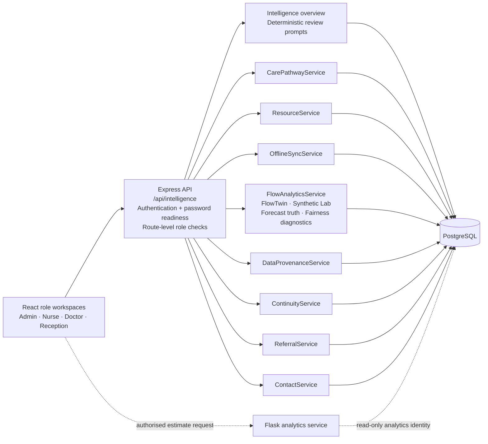
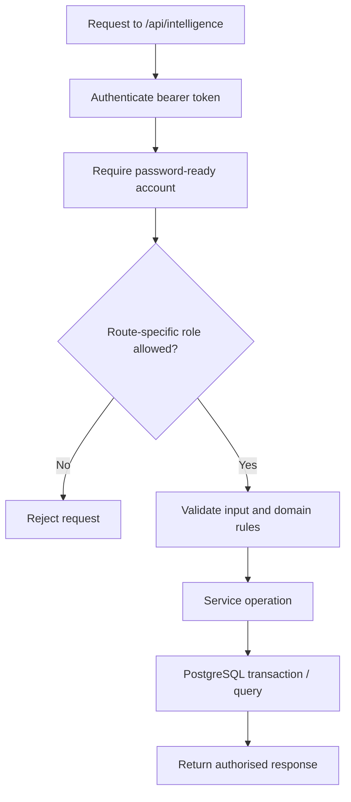

# Clinic Intelligence supplementary design models

**Source basis:** `backend/src/routes/intelligence.routes.js`, `backend/src/services/`, `db/migrations/003_clinic_intelligence.sql`, and `db/migrations/006_data_provenance.sql`–`008_backfill_reviewed_provenance_sources.sql`.

These diagrams supplement the core OPD use-case model. They do not replace it. The services shown are modules within the Express API, not separately deployed microservices.

## 1. Service and data boundary

## 2. Role-to-capability matrix

| Capability | ADMIN | NURSE | DOCTOR | RECEPTION |
|---|---:|---:|---:|---:|
| Intelligence overview / event log | Read | — | — | — |
| Active visits / pathway list / resource view | Read | Read | Read | — |
| Journey view | Read | Read | Read | Read |
| Assign/create pathways | Write | — | — | — |
| Update journey stage | Stage-role checked | Stage-role checked | Stage-role checked | Stage-role checked |
| Create/update resource status | Write | — | — | — |
| Offline resource sync | Write | — | — | — |
| FlowTwin / synthetic lab / forecast truth / fairness | Write/read | — | — | — |
| Data provenance review | Write/read | — | — | — |
| Continuity Lab | Write/read | — | — | — |
| Referral list | Read | Read | Read | — |
| Create/update referral | Write | — | Write | — |
| Read contact preferences | Read | Read | Read | Read |
| Update contact preferences / send update | Write | — | — | Write |

**Important:** stage updates are additionally constrained by each stage's configured required role and predecessor requirements. The contact-update send endpoint is rate-limited and requires recorded consent. This matrix is derived from route middleware; it is not proof that every matrix cell has been manually tested.

## 3. Role and endpoint flow

## 4. Capability boundaries

- **CareGraph:** ordered operational pathway tracking; not a clinical protocol.
- **Resources/offline sync:** resource-status outbox only; not offline registration, triage or consultation.
- **FlowTwin:** seeded planning simulation; does not automatically allocate staff, change patient priority or trigger care actions.
- **Forecast truth/fairness:** operational diagnostics; not clinical validation or proof of fairness.
- **Data provenance:** labels and review history; server policy does not authenticate identity or independently prove record authenticity.
- **Referral Relay:** internal referral tracking; no external health-system exchange.
- **Access Bridge:** consent-gated English SMS templates; no voice/WhatsApp or reviewed translations.
- **Operational Continuity Lab:** synthetic outage benchmark; not ingestion of actual paper forms or reconstruction of a real hospital outage.
- **Clinic insights:** deterministic, explainable operational review prompts; not a generative or diagnostic AI.

## 5. Verification boundary

The repository CI run recorded for code commit `4855a7d368d047baa4c3753cced7a6bd5c8ce5fd` is GitHub Actions run `39592355041` (run 470), conclusion `success`. It verifies only the steps configured in `.github/workflows/ci.yml`. Manual browser acceptance, exhaustive role/route testing, NFR-05 load/p95, NFR-06 Display Board latency, NFR-10 accessibility, backup restoration, live staging and clinical/operational approval remain separate evidence gates. See [the final submission handoff](FINAL_SUBMISSION_HANDOFF.md) and [release checklist](RELEASE_CHECKLIST.md).
